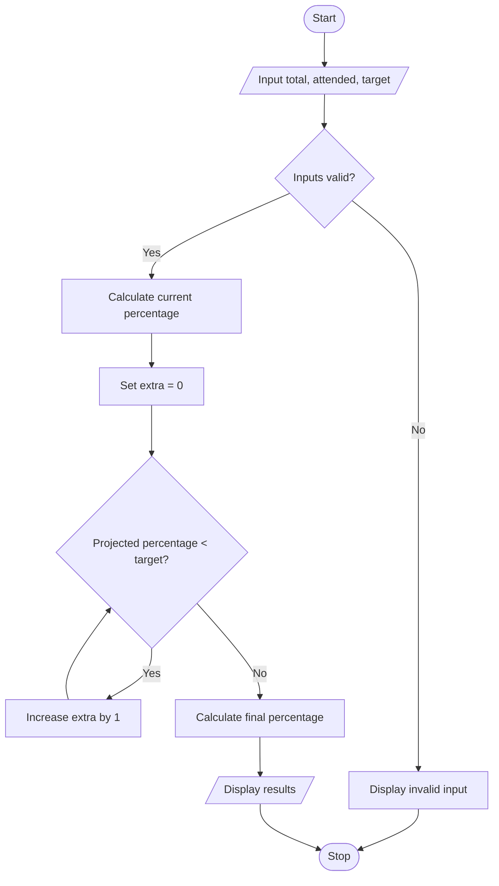

# Attendance Recovery Computation

**Selected case study:** Case 12

## 1. Problem statement
A student wants to know their current attendance percentage and how many additional consecutive classes they must attend to reach a required attendance percentage. The program accepts total classes held, classes attended, and the target percentage, then calculates the current percentage and the minimum extra classes needed.

## 2. Objectives
1. Read total classes, attended classes, and the required attendance percentage from the user.
2. Validate the entered values and reject impossible attendance data.
3. Calculate the current attendance percentage.
4. Use a while loop to find the minimum additional classes needed to reach the target.
5. Display the current and final attendance percentages.

## 3. Assumptions
- Total classes held must be greater than zero.
- Attended classes must be between zero and total classes held.
- The target attendance percentage must be greater than 0 and at most 100.
- The student attends every additional class without missing any.

## 4. Algorithm
1. Start the program.
2. Read total classes held, classes attended, and target attendance percentage.
3. Check whether the inputs are valid; if not, display an error.
4. Calculate current attendance = attended classes / total classes × 100.
5. Set additional classes to zero.
6. While the projected attendance is below the target, increase additional classes by one.
7. Calculate the final attendance percentage.
8. Display current attendance, additional classes required, and final attendance.
9. Stop.

## 5. Flowchart


## 6. Pseudocode
```text
BEGIN
  INPUT total, attended, target
  IF total <= 0 OR attended < 0 OR attended > total OR target <= 0 OR target > 100 THEN
      DISPLAY invalid input
  ELSE
      current = attended / total * 100
      extra = 0
      WHILE (attended + extra) / (total + extra) * 100 < target
          extra = extra + 1
      END WHILE
      final = (attended + extra) / (total + extra) * 100
      DISPLAY current, extra, final
  END IF
END
```

## 7. Python source code
The following is the same interactive `main.py` supplied in the replacement-code ZIP.

```python
def attendance_recovery(total_classes, attended_classes, target):
    if total_classes <= 0 or attended_classes < 0 or attended_classes > total_classes:
        return None
    if target <= 0 or target > 100:
        return None

    current = attended_classes / total_classes * 100
    extra = 0
    while (attended_classes + extra) / (total_classes + extra) * 100 < target:
        extra += 1
    final = (attended_classes + extra) / (total_classes + extra) * 100
    return current, extra, final

print("ATTENDANCE RECOVERY CALCULATOR")
try:
    total = int(input("Enter total classes held: "))
    attended = int(input("Enter classes attended: "))
    target = float(input("Enter required attendance percentage: "))
    result = attendance_recovery(total, attended, target)
    if result is None:
        print("Invalid input. Check the number of classes and target percentage.")
    else:
        current, extra, final = result
        print(f"Current attendance: {current:.2f}%")
        print("Additional consecutive classes to attend:", extra)
        print(f"Attendance after attending them: {final:.2f}%")
except ValueError:
    print("Please enter valid numeric values.")
```

## 8. Test cases

| Test | Input | Expected result |
|---:|---|---|
| 1 | 40; 28; 75 | Current = 70.00%; extra classes = 20; final = 75.00% |
| 2 | 50; 40; 75 | Current = 80.00%; extra classes = 0; final = 80.00% |
| 3 | 0; 0; 75 | Invalid input message |
| 4 | 10; 11; 75 | Invalid input message |
| 5 | 40; 28; 101 | Invalid input message |

## 9. Conclusion
The program calculates attendance percentage and determines the minimum number of consecutive classes required to reach a target. It demonstrates functions, arithmetic operations, validation, and a while loop.
