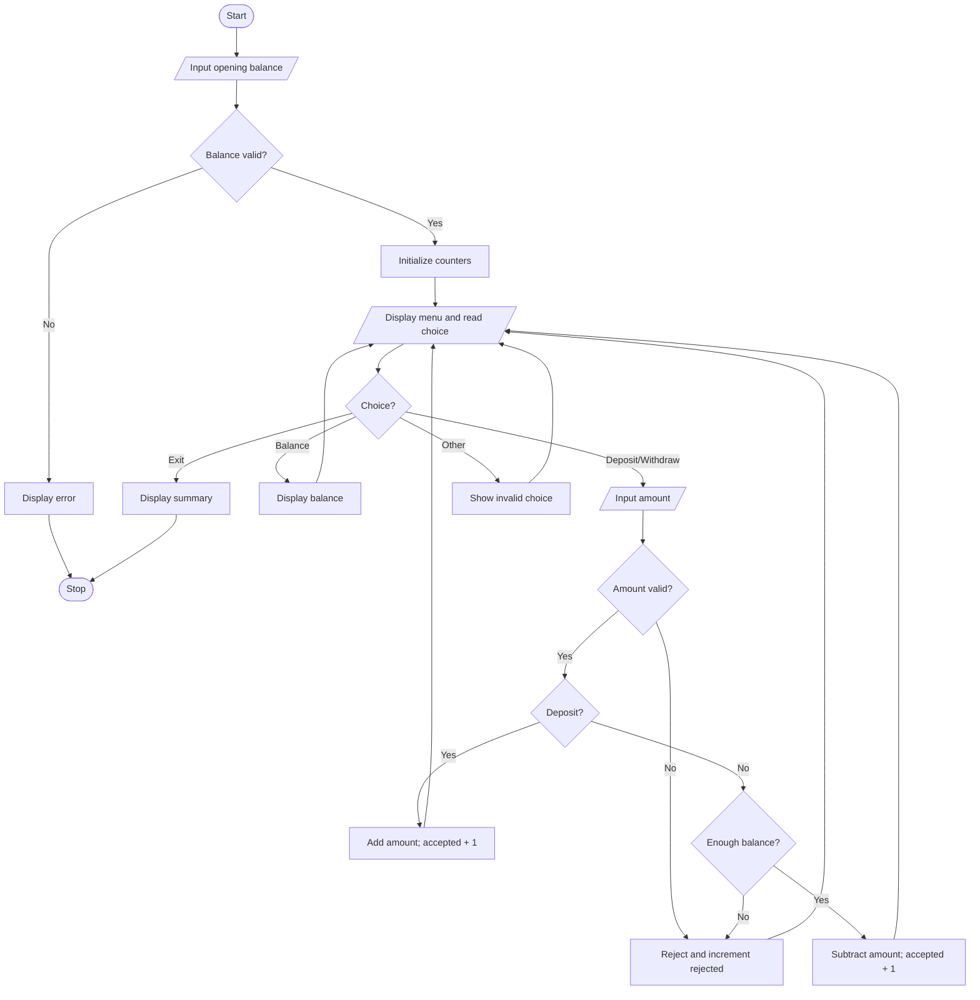

# ATM Transaction Sequence Simulation

**Selected case study:** Case 13

## 1. Problem statement
An ATM must process a sequence of deposit, withdrawal, balance enquiry, and exit operations. The program maintains the account balance, accepts valid transactions, rejects invalid amounts or withdrawals that exceed the available balance, and prints a transaction summary.

## 2. Objectives
1. Accept an opening account balance.
2. Provide a menu for deposit, withdrawal, balance enquiry, and exit.
3. Validate transaction amounts.
4. Update the balance for accepted transactions.
5. Count accepted and rejected transactions and display a final summary.

## 3. Assumptions
- The opening balance cannot be negative.
- Transaction amounts must be positive numbers.
- A withdrawal cannot exceed the available balance.
- The program handles one account in one run.
- Currency is displayed in Indian rupees.

## 4. Algorithm
1. Start and read the opening balance.
2. If the opening balance is negative or invalid, display an error.
3. Initialize accepted and rejected transaction counters to zero.
4. Repeatedly display the ATM menu until the user chooses Exit.
5. For Deposit or Withdraw, read and validate the amount.
6. For a valid deposit, add the amount to the balance and increment accepted count.
7. For a valid withdrawal with sufficient balance, subtract the amount and increment accepted count.
8. Otherwise reject the transaction and increment rejected count.
9. For Balance Enquiry, display the current balance.
10. On Exit, display final balance and transaction counts.
11. Stop.

## 5. Flowchart


## 6. Pseudocode
```text
BEGIN
  INPUT opening_balance
  IF opening_balance < 0 THEN DISPLAY error
  ELSE
      balance = opening_balance; accepted = 0; rejected = 0
      REPEAT
          DISPLAY menu
          INPUT choice
          IF choice is deposit or withdraw THEN
              INPUT amount
              IF amount is invalid or amount <= 0 THEN rejected = rejected + 1
              ELSE IF choice is deposit THEN balance = balance + amount; accepted = accepted + 1
              ELSE IF amount <= balance THEN balance = balance - amount; accepted = accepted + 1
              ELSE rejected = rejected + 1
          ELSE IF choice is balance enquiry THEN DISPLAY balance
          ELSE IF choice is exit THEN EXIT LOOP
          ELSE DISPLAY invalid choice
      END REPEAT
      DISPLAY balance, accepted, rejected
  END IF
END
```

## 7. Python source code
The following is the same interactive `main.py` supplied in the replacement-code ZIP.

```python
def run_atm(balance):
    accepted = 0
    rejected = 0
    while True:
        print("\n1. Deposit  2. Withdraw  3. Check balance  4. Exit")
        choice = input("Choose an option: ").strip()
        if choice == "1" or choice == "2":
            try:
                amount = float(input("Enter amount: "))
            except ValueError:
                print("Invalid amount.")
                rejected += 1
                continue
            if amount <= 0:
                print("Amount must be greater than zero.")
                rejected += 1
            elif choice == "1":
                balance += amount
                accepted += 1
                print(f"Deposit successful. Balance: Rs. {balance:.2f}")
            elif amount <= balance:
                balance -= amount
                accepted += 1
                print(f"Withdrawal successful. Balance: Rs. {balance:.2f}")
            else:
                print("Transaction rejected: insufficient balance.")
                rejected += 1
        elif choice == "3":
            print(f"Available balance: Rs. {balance:.2f}")
        elif choice == "4":
            break
        else:
            print("Choose a valid option from 1 to 4.")
    print("\nATM SUMMARY")
    print(f"Final balance: Rs. {balance:.2f}")
    print("Accepted transactions:", accepted)
    print("Rejected transactions:", rejected)

print("ATM TRANSACTION SIMULATOR")
try:
    opening = float(input("Enter opening balance (Rs.): "))
    if opening < 0:
        print("Opening balance cannot be negative.")
    else:
        run_atm(opening)
except ValueError:
    print("Please enter a valid balance.")
```

## 8. Test cases

| Test | Input | Expected result |
|---:|---|---|
| 1 | Opening 1000; choices 1, amount 500; 3; 4 | Deposit succeeds; balance Rs. 1500.00; accepted 1; rejected 0 |
| 2 | Opening 1000; choices 2, amount 300; 4 | Withdrawal succeeds; final balance Rs. 700.00 |
| 3 | Opening 100; withdraw 200; exit | Insufficient balance; rejected 1; final balance Rs. 100.00 |
| 4 | Opening 500; deposit -10; exit | Amount must be greater than zero; rejected 1 |
| 5 | Opening -5 | Opening balance cannot be negative |

## 9. Conclusion
The ATM simulator models a simple transaction sequence and maintains an accurate running balance. It demonstrates loops, conditional statements, numeric input validation, and counters.
