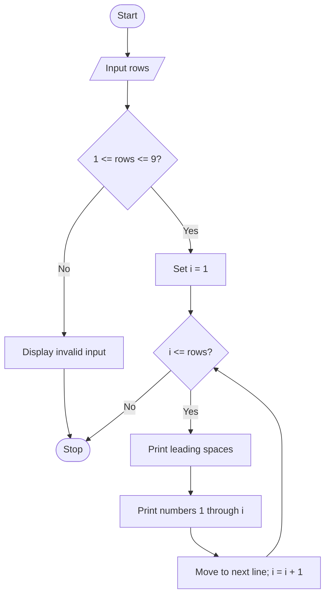

# Advanced Numeric Pattern Generator

**Selected case study:** Case 27

## 1. Problem statement
A user needs a centered numerical pyramid pattern whose height is selected at runtime. The program accepts a row count from 1 to 9 and prints an aligned pyramid with increasing numbers on each row.

## 2. Objectives
1. Accept the number of rows from the user.
2. Validate that the row count is between 1 and 9.
3. Use nested loops to generate the pyramid.
4. Print leading spaces to center the pattern.
5. Display a clear message for invalid input.

## 3. Assumptions
- The number of rows must be a whole number from 1 through 9.
- Each row starts at 1 and prints numbers up to the row number.
- The pattern is a left-to-right increasing number pyramid, not a hollow diamond.
- The selected limit keeps the pattern compact.

## 4. Algorithm
1. Start the program.
2. Read the number of rows.
3. If the value is not an integer or is outside 1 to 9, display an error.
4. For each row i from 1 to rows, print rows minus i groups of spaces.
5. For each number from 1 to i, print the number on the same line.
6. Move to the next line after completing each row.
7. Stop.

## 5. Flowchart


## 6. Pseudocode
```text
BEGIN
  INPUT rows
  IF rows < 1 OR rows > 9 THEN
      DISPLAY error
  ELSE
      FOR i = 1 TO rows
          PRINT two spaces repeated (rows - i) times
          FOR number = 1 TO i
              PRINT number on same line
          END FOR
          PRINT newline
      END FOR
  END IF
END
```

## 7. Python source code
The following is the same interactive `main.py` supplied in the replacement-code ZIP.

```python
print("NUMBER PYRAMID GENERATOR")
try:
    rows = int(input("Enter number of rows (1 to 9): "))
    if rows < 1 or rows > 9:
        print("Please enter a number from 1 to 9.")
    else:
        for i in range(1, rows + 1):
            print("  " * (rows - i), end="")
            for number in range(1, i + 1):
                print(number, end=" ")
            print()
except ValueError:
    print("Please enter a whole number.")
```

## 8. Test cases

| Test | Input | Expected result |
|---:|---|---|
| 1 | 3 |     1\n  1 2\n1 2 3 |
| 2 | 1 | 1 |
| 3 | 5 | Five rows are printed, ending with 1 2 3 4 5 |
| 4 | 0 | Please enter a number from 1 to 9 |
| 5 | abc | Please enter a whole number |

## 9. Conclusion
The pattern generator uses nested for loops and formatted printing to create a centered number pyramid. It demonstrates iteration, range, validation, and output formatting.
