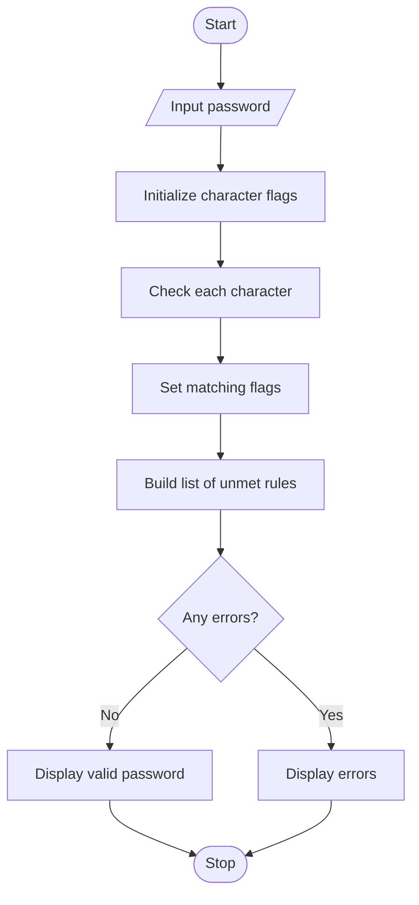

# Password Policy Validation Engine

**Selected case study:** Case 29

## 1. Problem statement
A system needs to check whether a password follows a basic security policy. The program checks the entered password for minimum length, uppercase letters, lowercase letters, digits, and special characters, then reports every rule that is not satisfied.

## 2. Objectives
1. Accept a password from the user.
2. Check the password length.
3. Check for uppercase and lowercase letters.
4. Check for at least one digit and one special character.
5. Display success or a list of missing requirements.

## 3. Assumptions
- A valid password must contain at least 8 characters.
- At least one uppercase letter, one lowercase letter, one digit, and one special character are required.
- Any character that is not an uppercase letter, lowercase letter, or digit is treated as a special character.
- This is a classroom validation example, not a complete production password-security system.

## 4. Algorithm
1. Start the program and read a password.
2. Initialize four Boolean flags as False.
3. Visit each character in the password.
4. Set the corresponding flag when an uppercase, lowercase, digit, or special character is found.
5. Create an empty list of errors.
6. Add an error message for each requirement that is not satisfied.
7. If the error list is empty, display that the password is valid.
8. Otherwise display that the password is invalid and list the errors.
9. Stop.

## 5. Flowchart


## 6. Pseudocode
```text
BEGIN
  INPUT password
  SET upper, lower, digit, special = FALSE
  FOR EACH character ch IN password
      IF ch is uppercase THEN upper = TRUE
      ELSE IF ch is lowercase THEN lower = TRUE
      ELSE IF ch is digit THEN digit = TRUE
      ELSE special = TRUE
  END FOR
  errors = empty list
  IF length(password) < 8 ADD length error
  IF NOT upper ADD uppercase error
  IF NOT lower ADD lowercase error
  IF NOT digit ADD digit error
  IF NOT special ADD special-character error
  IF errors is empty DISPLAY valid
  ELSE DISPLAY invalid and errors
END
```

## 7. Python source code
The following is the same interactive `main.py` supplied in the replacement-code ZIP.

```python
def validate_password(password):
    has_upper = has_lower = has_digit = has_special = False
    for ch in password:
        if ch.isupper():
            has_upper = True
        elif ch.islower():
            has_lower = True
        elif ch.isdigit():
            has_digit = True
        else:
            has_special = True

    errors = []
    if len(password) < 8:
        errors.append("Use at least 8 characters")
    if not has_upper:
        errors.append("Add at least one uppercase letter")
    if not has_lower:
        errors.append("Add at least one lowercase letter")
    if not has_digit:
        errors.append("Add at least one digit")
    if not has_special:
        errors.append("Add at least one special character")
    return errors

print("PASSWORD POLICY VALIDATOR")
password = input("Enter a password to check: ")
problems = validate_password(password)
if not problems:
    print("Password is valid and meets all rules.")
else:
    print("Password is invalid:")
    for problem in problems:
        print("-", problem)
```

## 8. Test cases

| Test | Input | Expected result |
|---:|---|---|
| 1 | Abc@1234 | Password is valid and meets all rules |
| 2 | abc@1234 | Invalid: add uppercase letter |
| 3 | ABC@1234 | Invalid: add lowercase letter |
| 4 | Abcdefgh@ | Invalid: add digit |
| 5 | Ab1@ | Invalid: at least 8 characters |
| 6 | Abc12345 | Invalid: add special character |

## 9. Conclusion
The validator checks a password against five simple rules and reports all unmet requirements. It demonstrates strings, character testing, Boolean variables, loops, and conditional statements.
