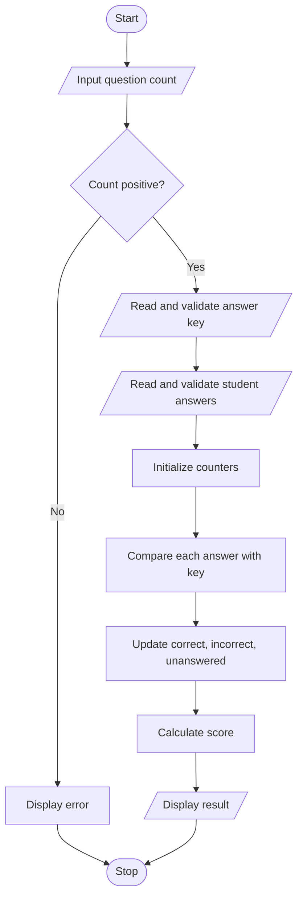

# String-Based Examination Answer Evaluation

**Selected case study:** Case 31

## 1. Problem statement
An examiner wants to compare a student's multiple-choice answers with an answer key. The program reads the number of questions, the correct answers, and the student's answers, then counts correct, incorrect, and unanswered questions and calculates a score with a penalty of 0.25 for each incorrect answer.

## 2. Objectives
1. Read a positive number of questions.
2. Accept an answer key using A, B, C, or D.
3. Accept student answers using A, B, C, D, or blank for unanswered.
4. Count correct, incorrect, and unanswered responses.
5. Calculate and display the final score.

## 3. Assumptions
- Every question has one correct option among A, B, C, and D.
- Input is converted to uppercase before comparison.
- A blank student response is treated as unanswered.
- Each correct answer earns 1 mark, each incorrect answer loses 0.25 mark, and unanswered answers earn 0.
- The answer key and student response list have the same length.

## 4. Algorithm
1. Start and read the number of questions.
2. If the count is not positive or not an integer, display an error.
3. Read and validate one answer-key option for each question.
4. Read and validate one student answer for each question; allow blank input.
5. Initialize correct, incorrect, and unanswered counters to zero.
6. Compare each student answer with the matching key answer.
7. Increase the appropriate counter for correct, incorrect, or unanswered.
8. Calculate score = correct minus 0.25 times incorrect.
9. Display the counts and final score out of the total number of questions.
10. Stop.

## 5. Flowchart


## 6. Pseudocode
```text
BEGIN
  INPUT count
  IF count <= 0 THEN DISPLAY error
  ELSE
      FOR each question INPUT and validate key answer A/B/C/D
      FOR each question INPUT and validate student answer A/B/C/D or blank
      correct = 0; incorrect = 0; unanswered = 0
      FOR i = 0 TO count - 1
          IF answers[i] is blank THEN unanswered = unanswered + 1
          ELSE IF answers[i] = key[i] THEN correct = correct + 1
          ELSE incorrect = incorrect + 1
      END FOR
      score = correct - 0.25 * incorrect
      DISPLAY counts and score
  END IF
END
```

## 7. Python source code
The following is the same interactive `main.py` supplied in the replacement-code ZIP.

```python
def evaluate_answers(key, answers):
    correct = incorrect = unanswered = 0
    for i in range(len(key)):
        if answers[i] == "":
            unanswered += 1
        elif answers[i] == key[i]:
            correct += 1
        else:
            incorrect += 1
    score = correct - 0.25 * incorrect
    print("\nEXAM RESULT")
    print("Correct answers:", correct)
    print("Incorrect answers:", incorrect)
    print("Unanswered:", unanswered)
    print(f"Final score: {score:.2f} out of {len(key)}")

print("EXAM ANSWER EVALUATOR")
try:
    count = int(input("Enter number of questions: "))
    if count <= 0:
        print("Number of questions must be positive.")
    else:
        key = []
        answers = []
        print("Enter the answer key (A/B/C/D):")
        for i in range(count):
            value = input(f"Correct answer for Q{i+1}: ").strip().upper()
            while value not in ["A", "B", "C", "D"]:
                value = input("Enter A, B, C or D: ").strip().upper()
            key.append(value)
        print("Enter student's answers. Press Enter if unanswered.")
        for i in range(count):
            value = input(f"Student answer for Q{i+1}: ").strip().upper()
            while value not in ["", "A", "B", "C", "D"]:
                value = input("Enter A, B, C, D or blank: ").strip().upper()
            answers.append(value)
        evaluate_answers(key, answers)
except ValueError:
    print("Please enter a valid whole number.")
```

## 8. Test cases

| Test | Input | Expected result |
|---:|---|---|
| 1 | Key A,B,C; student A,B,C | Correct 3; incorrect 0; unanswered 0; score 3.00/3 |
| 2 | Key A,B,C; student B,A,C | Correct 1; incorrect 2; unanswered 0; score 0.50/3 |
| 3 | Key A,B,C; student A,blank,C | Correct 2; incorrect 0; unanswered 1; score 2.00/3 |
| 4 | Question count 0 | Number of questions must be positive |
| 5 | Key A; student D | Correct 0; incorrect 1; score -0.25/1 |

## 9. Conclusion
The evaluator compares two answer sequences and calculates a score with negative marking. It demonstrates lists, strings, loops, comparisons, counters, and arithmetic.
