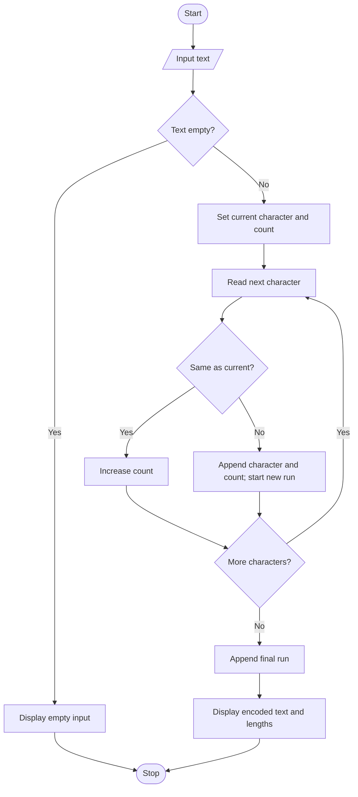

# Text Compression Using Character Runs

**Selected case study:** Case 35

## 1. Problem statement
A user wants to shorten text that contains consecutive repeated characters. The program applies run-length encoding by replacing each consecutive group of identical characters with the character followed by its repetition count.

## 2. Objectives
1. Accept a text string from the user.
2. Identify consecutive runs of identical characters.
3. Count the characters in each run.
4. Build and display the compressed string.
5. Compare original and compressed lengths.

## 3. Assumptions
- Only consecutive repeated characters are grouped.
- Character order is preserved.
- Each run is represented by the character followed by its count, including count 1.
- The program reports whether the encoded text is shorter; it does not decode the result.

## 4. Algorithm
1. Start and read a text string.
2. If the string is empty, display an empty-input message.
3. Set the current character to the first character and count to one.
4. Scan each remaining character.
5. If it matches the current character, increase the count.
6. Otherwise append the current character and count to the result, then start a new run.
7. After the loop, append the final character and count.
8. Display the original and compressed strings and their lengths.
9. Report whether compression is beneficial.
10. Stop.

## 5. Flowchart


## 6. Pseudocode
```text
BEGIN
  INPUT text
  IF text is empty THEN DISPLAY empty input
  ELSE
      result = ""
      current = first character
      count = 1
      FOR each character ch after first
          IF ch = current THEN count = count + 1
          ELSE
              result = result + current + count
              current = ch; count = 1
          END IF
      END FOR
      result = result + current + count
      DISPLAY text, result, lengths
      IF length(result) < length(text) DISPLAY compression beneficial
      ELSE DISPLAY compression not beneficial
  END IF
END
```

## 7. Python source code
The following is the same interactive `main.py` supplied in the replacement-code ZIP.

```python
def compress_text(text):
    if text == "":
        return ""
    result = ""
    current = text[0]
    count = 1
    for ch in text[1:]:
        if ch == current:
            count += 1
        else:
            result += current + str(count)
            current = ch
            count = 1
    result += current + str(count)
    return result

print("RUN-LENGTH TEXT COMPRESSION")
message = input("Enter text to compress: ")
if not message:
    print("Input text is empty.")
else:
    encoded = compress_text(message)
    print("Original text:", message)
    print("Compressed text:", encoded)
    print("Original length:", len(message))
    print("Compressed length:", len(encoded))
    if len(encoded) < len(message):
        print("Compression is beneficial.")
    else:
        print("Compression is not beneficial; keep the original text.")
```

## 8. Test cases

| Test | Input | Expected result |
|---:|---|---|
| 1 | aaabbc | a3b2c1; compressed length 6; not beneficial for this input |
| 2 | aaaaa | a5; compressed length 2; beneficial |
| 3 | abcd | a1b1c1d1; not beneficial |
| 4 | empty string | Input text is empty |
| 5 | aabbaa | a2b2a2 |

## 9. Conclusion
The program applies run-length encoding to consecutive repeated characters and compares the encoded length with the original. It demonstrates string traversal, counters, loops, and string concatenation.
