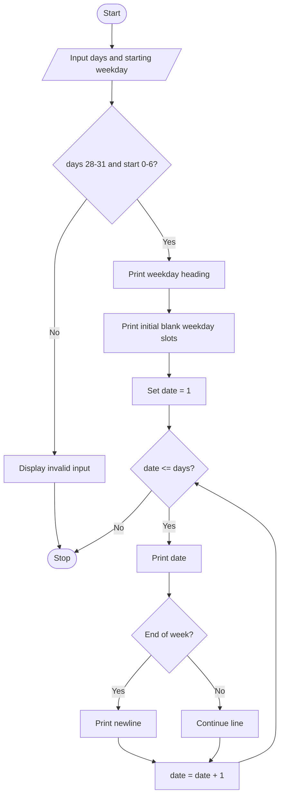

# Nested Loop Calendar Generator

**Selected case study:** Case 37

## 1. Problem statement
A user wants to display a simple monthly calendar by entering the number of days in the month and the weekday on which the month starts. The program validates these values and prints dates under Sunday-to-Saturday headings.

## 2. Objectives
1. Accept the number of days in a month.
2. Accept the starting weekday using a number from 0 to 6.
3. Validate the month length and weekday value.
4. Print a calendar heading and align the first date under the correct weekday.
5. Use iteration to print all dates.

## 3. Assumptions
- The month has between 28 and 31 days.
- Weekday numbering is 0 for Sunday, 1 for Monday, through 6 for Saturday.
- The calendar uses a Sunday-first week.
- The user supplies the correct month length and starting weekday; the program does not calculate leap years or weekdays from a year/month.

## 4. Algorithm
1. Start and read the number of days and starting weekday.
2. Validate that days is from 28 to 31 and start is from 0 to 6.
3. If invalid, display an error.
4. Print weekday headings from Sunday to Saturday.
5. Print blank spaces for the weekdays before the first day.
6. For each date from 1 to the number of days, print the date.
7. After each Saturday position, move to a new line.
8. Print a final newline and stop.

## 5. Flowchart


## 6. Pseudocode
```text
BEGIN
  INPUT days, start
  IF days < 28 OR days > 31 OR start < 0 OR start > 6 THEN DISPLAY error
  ELSE
      PRINT Sun Mon Tue Wed Thu Fri Sat
      PRINT four spaces repeated start times
      FOR date = 1 TO days
          PRINT date in a 3-character field
          IF (start + date) MOD 7 = 0 THEN PRINT newline
      END FOR
      PRINT newline
  END IF
END
```

## 7. Python source code
The following is the same interactive `main.py` supplied in the replacement-code ZIP.

```python
print("MONTHLY CALENDAR GENERATOR")
try:
    days = int(input("Enter number of days in the month (28-31): "))
    start = int(input("Starting weekday (0=Sun, 1=Mon, ..., 6=Sat): "))
    if days < 28 or days > 31 or start < 0 or start > 6:
        print("Invalid month length or starting weekday.")
    else:
        print("Sun Mon Tue Wed Thu Fri Sat")
        print("    " * start, end="")
        for date in range(1, days + 1):
            print(f"{date:3} ", end="")
            if (start + date) % 7 == 0:
                print()
        print()
except ValueError:
    print("Please enter whole numbers only.")
```

## 8. Test cases

| Test | Input | Expected result |
|---:|---|---|
| 1 | Days 31; start 0 | Calendar starts with 1 under Sunday and prints dates 1 to 31 |
| 2 | Days 30; start 3 | Three blank weekday slots appear before date 1 |
| 3 | Days 28; start 6 | Date 1 appears under Saturday |
| 4 | Days 32; start 0 | Invalid month length or starting weekday |
| 5 | Days 30; start 7 | Invalid month length or starting weekday |

## 9. Conclusion
The calendar generator arranges a supplied month into weekday columns. It demonstrates loops, conditional line breaks, numeric formatting, and input validation.
