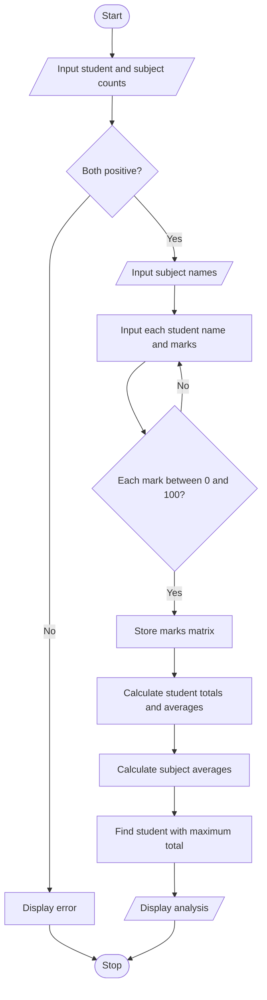

# Student Marks Matrix Analysis

**Selected case study:** Case 42

## 1. Problem statement
A teacher wants to analyse marks for multiple students across multiple subjects. The program stores marks in a two-dimensional list, calculates each student's total and average, calculates each subject's average, and identifies the student with the highest total.

## 2. Objectives
1. Read the number of students and subjects.
2. Accept subject names and student names.
3. Store marks in a nested list (matrix).
4. Validate marks to ensure they are between 0 and 100.
5. Calculate student totals and averages, subject averages, and the top student.

## 3. Assumptions
- At least one student and one subject must be entered.
- Each mark is numeric and between 0 and 100 inclusive.
- All students are assessed in the same subjects.
- If two students share the same highest total, the first one entered is reported.
- Averages are calculated using the number of subjects or students as appropriate.

## 4. Algorithm
1. Start and read student and subject counts.
2. Validate that both counts are positive.
3. Read all subject names.
4. For each student, read the name and marks for every subject.
5. Reject and re-prompt marks outside 0 to 100.
6. Store each student's marks as one row in a nested list.
7. Calculate and display each student's total and average.
8. For each subject, calculate and display the average across all students.
9. Find the index of the highest student total and display that student.
10. Stop.

## 5. Flowchart


## 6. Pseudocode
```text
BEGIN
  INPUT student_count, subject_count
  IF either count <= 0 THEN DISPLAY error
  ELSE
      INPUT subject_names
      FOR each student
          INPUT student name
          FOR each subject
              INPUT mark
              WHILE mark < 0 OR mark > 100 INPUT mark again
              STORE mark in row
          END FOR
          APPEND row to marks matrix
      END FOR
      FOR each student row
          total = SUM(row)
          average = total / subject_count
          DISPLAY total and average
      END FOR
      FOR each subject column
          average = SUM(all student marks in column) / student_count
          DISPLAY subject average
      END FOR
      DISPLAY student with maximum total
  END IF
END
```

## 7. Python source code
The following is the same interactive `main.py` supplied in the replacement-code ZIP.

```python
print("STUDENT MARKS MATRIX ANALYSIS")
try:
    student_count = int(input("Enter number of students: "))
    subject_count = int(input("Enter number of subjects: "))
    if student_count <= 0 or subject_count <= 0:
        print("Students and subjects must be greater than zero.")
    else:
        names = []
        subject_names = []
        marks = []
        for j in range(subject_count):
            subject_names.append(input(f"Enter subject {j+1} name: "))
        for i in range(student_count):
            name = input(f"Enter student {i+1} name: ")
            names.append(name)
            row = []
            for j in range(subject_count):
                mark = float(input(f"Enter {subject_names[j]} marks for {name} (0-100): "))
                while mark < 0 or mark > 100:
                    print("Marks must be between 0 and 100.")
                    mark = float(input(f"Enter {subject_names[j]} marks: "))
                row.append(mark)
            marks.append(row)
        totals = []
        print("\nSTUDENT RESULTS")
        for i in range(student_count):
            total = sum(marks[i])
            totals.append(total)
            print(names[i], "Total:", total, "Average:", round(total / subject_count, 2))
        print("\nSUBJECT AVERAGES")
        for j in range(subject_count):
            average = sum(marks[i][j] for i in range(student_count)) / student_count
            print(subject_names[j], ":", round(average, 2))
        top = totals.index(max(totals))
        print("\nTop student:", names[top], "with", totals[top], "marks")
except ValueError:
    print("Please enter valid numeric marks and counts.")
```

## 8. Test cases

| Test | Input | Expected result |
|---:|---|---|
| 1 | 2 students, 2 subjects; A: 80,90; B: 70,80 | A total 170 average 85; B total 150 average 75; subject averages 75 and 85; top A |
| 2 | 1 student, 1 subject; mark 100 | Total 100; average 100; student is top |
| 3 | Mark -5 then 75 | Program rejects -5 and asks again; stores 75 |
| 4 | Student count 0 | Students and subjects must be greater than zero |
| 5 | Mark 105 then 90 | Program rejects 105 and asks again; stores 90 |

## 9. Conclusion
The program analyses student performance using a two-dimensional list. It demonstrates nested lists, nested loops, sums, averages, validation, and finding a maximum value.
