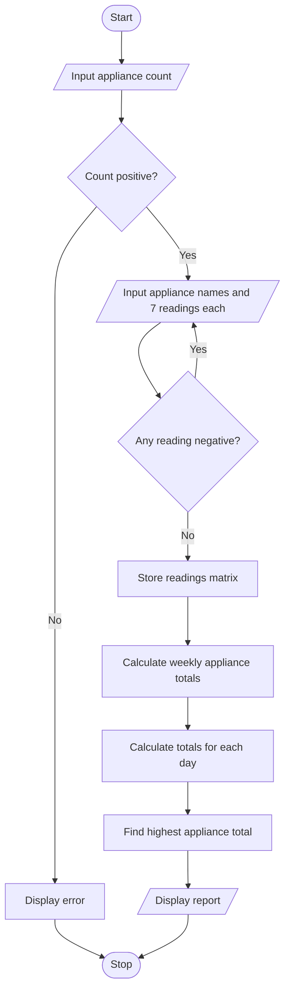

# Weekly Electricity Consumption Matrix

**Selected case study:** Case 45

## 1. Problem statement
A household wants to analyse electricity consumption for several appliances over seven days. The program stores daily kWh readings for each appliance, calculates weekly appliance totals and daily totals, and identifies the appliance with the highest weekly consumption.

## 2. Objectives
1. Accept the number and names of appliances.
2. Read seven daily electricity readings for each appliance.
3. Store readings in a nested list.
4. Reject negative readings.
5. Calculate weekly totals for each appliance and daily totals across appliances.
6. Identify the appliance with the highest weekly consumption.

## 3. Assumptions
- At least one appliance is entered.
- Each appliance has exactly seven daily readings.
- Readings are numeric values in kWh and cannot be negative.
- The program analyses entered values only and does not calculate electricity bills.
- If appliances tie for the highest usage, the first one entered is displayed.

## 4. Algorithm
1. Start and read the number of appliances.
2. Validate that the count is positive.
3. For each appliance, read its name and seven daily kWh readings.
4. Reject and re-prompt any negative reading.
5. Store each appliance's readings as a row in a nested list.
6. Calculate and display the sum of each row as the appliance's weekly total.
7. For each of the seven days, add readings from all appliances and display the daily total.
8. Find and display the appliance with the highest weekly total.
9. Stop.

## 5. Flowchart


## 6. Pseudocode
```text
BEGIN
  INPUT appliance_count
  IF appliance_count <= 0 THEN DISPLAY error
  ELSE
      FOR each appliance
          INPUT appliance name
          FOR day = 1 TO 7
              INPUT kWh reading
              WHILE reading < 0 INPUT reading again
              STORE reading in row
          END FOR
          APPEND row to readings matrix
      END FOR
      FOR each appliance row
          total = SUM(row)
          DISPLAY appliance and total
      END FOR
      FOR day = 1 TO 7
          daily_total = SUM(readings for that day across all appliances)
          DISPLAY daily_total
      END FOR
      DISPLAY appliance with maximum weekly total
  END IF
END
```

## 7. Python source code
The following is the same interactive `main.py` supplied in the replacement-code ZIP.

```python
print("WEEKLY ELECTRICITY CONSUMPTION ANALYSIS")
try:
    count = int(input("Enter number of appliances: "))
    if count <= 0:
        print("Enter at least one appliance.")
    else:
        appliances = []
        readings = []
        for i in range(count):
            name = input(f"Enter appliance {i+1} name: ")
            appliances.append(name)
            row = []
            print(f"Enter daily kWh usage for {name} (7 days):")
            for day in range(7):
                value = float(input(f"Day {day+1}: "))
                while value < 0:
                    print("Usage cannot be negative.")
                    value = float(input(f"Day {day+1}: "))
                row.append(value)
            readings.append(row)
        totals = []
        print("\nWEEKLY APPLIANCE TOTALS")
        for i in range(count):
            total = sum(readings[i])
            totals.append(total)
            print(appliances[i], ":", round(total, 2), "kWh")
        print("\nDAILY TOTALS")
        for day in range(7):
            daily = sum(readings[i][day] for i in range(count))
            print("Day", day+1, ":", round(daily, 2), "kWh")
        highest = totals.index(max(totals))
        print("\nHighest consumption:", appliances[highest], round(totals[highest], 2), "kWh")
except ValueError:
    print("Please enter valid numeric values.")
```

## 8. Test cases

| Test | Input | Expected result |
|---:|---|---|
| 1 | One appliance with readings 1,2,3,4,5,6,7 | Weekly total 28 kWh; daily totals 1 to 7; appliance is highest |
| 2 | Two appliances: A all 1s; B all 2s | A total 7 kWh; B total 14 kWh; daily totals 3 kWh; B highest |
| 3 | Negative reading -1 then 2 | Program rejects -1 and asks again; stores 2 |
| 4 | Appliance count 0 | Enter at least one appliance |
| 5 | All readings 0 | Weekly and daily totals are 0; first appliance is reported as highest |

## 9. Conclusion
The program processes seven-day electricity readings using a matrix and calculates both row-wise and column-wise totals. It demonstrates nested lists, loops, validation, and aggregation.
