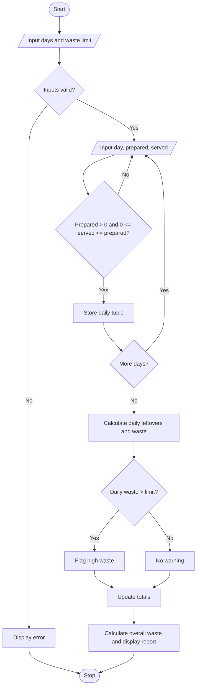

# Food Waste Monitoring System

**Selected case study:** Case 53

## 1. Problem statement
A canteen wants to monitor the number of meals prepared, served, and left over across multiple days. The program calculates daily and overall food-waste percentages, compares each day's waste with an acceptable limit, and displays a summary report.

## 2. Objectives
1. Read the number of days and acceptable waste percentage limit.
2. Accept the day name, meals prepared, and meals served for each day.
3. Validate prepared and served meal counts.
4. Store daily records as tuples in a list.
5. Calculate daily leftovers and waste percentages.
6. Calculate overall prepared, served, leftover, and waste totals.
7. Flag days whose waste percentage exceeds the set limit.

## 3. Assumptions
- The number of days must be positive.
- The acceptable waste limit must be between 0 and 100 percent.
- Meals prepared must be greater than zero.
- Meals served must be between zero and meals prepared.
- Leftovers are calculated as prepared minus served.
- Waste percentage is leftovers divided by meals prepared, multiplied by 100.

## 4. Algorithm
1. Start and read the number of days and acceptable waste limit.
2. Validate the number of days and limit.
3. For each day, read the day name, meals prepared, and meals served.
4. Validate that prepared is positive and served is between zero and prepared; re-prompt if invalid.
5. Store each record as a tuple in a list.
6. Initialize overall totals to zero.
7. For each record, calculate leftovers and daily waste percentage.
8. Display the daily report and flag waste percentages above the limit.
9. Add daily prepared, served, and leftover values to overall totals.
10. Calculate and display overall waste percentage.
11. Stop.

## 5. Flowchart


## 6. Pseudocode
```text
BEGIN
  INPUT days, limit
  IF days <= 0 OR limit < 0 OR limit > 100 THEN DISPLAY error
  ELSE
      records = empty list
      FOR each day from 1 to days
          INPUT day_name, prepared, served
          WHILE prepared <= 0 OR served < 0 OR served > prepared
              INPUT prepared and served again
          END WHILE
          APPEND (day_name, prepared, served) to records
      END FOR
      total_prepared = 0; total_served = 0; total_leftover = 0
      FOR EACH (day, prepared, served) IN records
          leftover = prepared - served
          waste = leftover / prepared * 100
          DISPLAY daily details
          IF waste > limit DISPLAY high-waste warning
          ADD values to overall totals
      END FOR
      overall_waste = total_leftover / total_prepared * 100
      DISPLAY overall totals and overall_waste
  END IF
END
```

## 7. Python source code
The following is the same interactive `main.py` supplied in the replacement-code ZIP.

```python
print("FOOD WASTE MONITORING SYSTEM")
try:
    days = int(input("Enter number of days to record: "))
    limit = float(input("Enter acceptable waste limit percentage: "))
    if days <= 0 or limit < 0 or limit > 100:
        print("Enter a positive number of days and a limit from 0 to 100.")
    else:
        records = []
        for i in range(days):
            day = input(f"Enter day {i+1} name: ")
            prepared = int(input("Meals prepared: "))
            served = int(input("Meals served: "))
            while prepared <= 0 or served < 0 or served > prepared:
                print("Invalid values: prepared must be positive and served cannot exceed prepared.")
                prepared = int(input("Meals prepared: "))
                served = int(input("Meals served: "))
            records.append((day, prepared, served))
        print("\nFOOD WASTE REPORT")
        total_prepared = total_served = total_leftover = 0
        for day, prepared, served in records:
            leftover = prepared - served
            waste = leftover / prepared * 100
            total_prepared += prepared
            total_served += served
            total_leftover += leftover
            print(f"{day}: Prepared={prepared}, Served={served}, Leftovers={leftover}, Waste={waste:.2f}%")
            if waste > limit:
                print("  HIGH WASTE: exceeds the set limit")
        overall = total_leftover / total_prepared * 100
        print("\nTOTAL PREPARED:", total_prepared)
        print("TOTAL SERVED:", total_served)
        print("TOTAL LEFTOVERS:", total_leftover)
        print(f"OVERALL WASTE: {overall:.2f}%")
except ValueError:
    print("Please enter valid numeric values.")
```

## 8. Test cases

| Test | Input | Expected result |
|---:|---|---|
| 1 | 1 day; limit 10%; prepared 100; served 90 | Leftovers 10; waste 10.00%; no high-waste warning because it does not exceed limit |
| 2 | 1 day; limit 10%; prepared 100; served 80 | Leftovers 20; waste 20.00%; high-waste warning |
| 3 | 2 days: (100,80), (50,50) | Totals prepared 150, served 130, leftovers 20; overall waste 13.33% |
| 4 | Prepared 0 | Program rejects the values and asks again |
| 5 | Prepared 10; served 12 | Program rejects served greater than prepared and asks again |

## 9. Conclusion
The food-waste monitor records daily meal data and reports daily and overall waste. It demonstrates tuples, lists, loops, arithmetic, validation, and conditional alerts.
